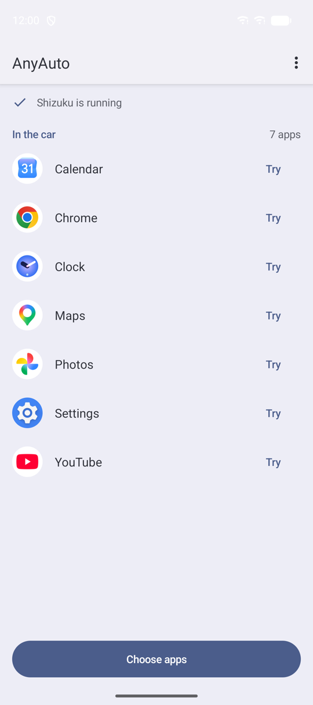
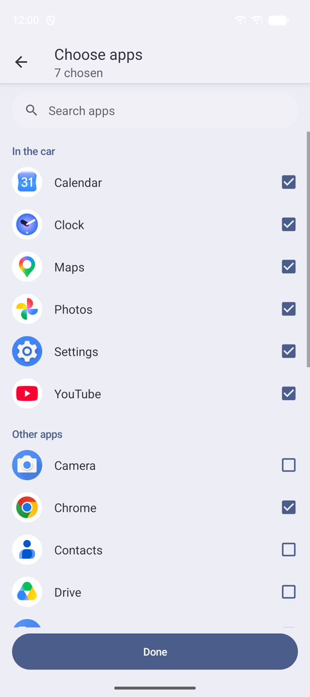
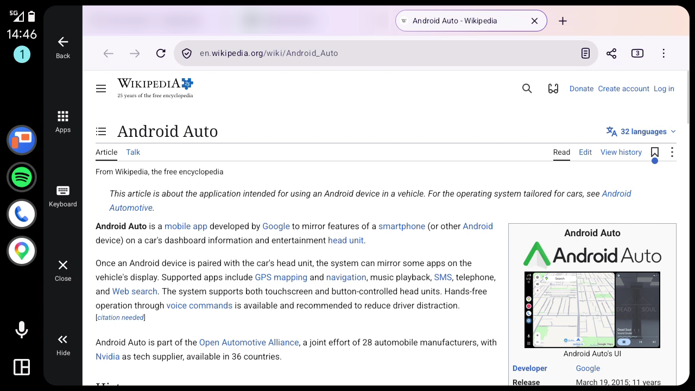
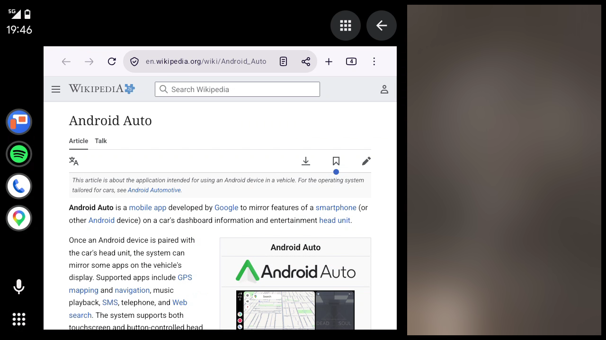

# AnyAuto

[](https://github.com/GitMag/AnyAuto/releases/latest)
[](https://ko-fi.com/forsblomdev)

<p align="center"></p>

AnyAuto puts **ordinary phone apps on the Android Auto screen**: a browser, a video app,
Settings, or anything else with a launcher icon. You don't change the apps. AnyAuto runs them
on a car-sized virtual display and draws it onto the car screen. Touch screens work as you'd
expect, and cars with a rotary knob or a touchpad get a pointer.

It uses [Shizuku](https://shizuku.rikka.app/), so you don't need root or a computer in the
car. No account, no analytics. The only thing it does online is check GitHub for a new version
when you open it, and you can turn that off.

**[Download the APK](https://github.com/GitMag/AnyAuto/releases/latest)** from the latest release.

<p align="center"></p>

<p align="center"><em>YouTube on the Android Auto screen, with AnyAuto's navigation bar at the left.
Video: <a href="https://peach.blender.org/">Big Buck Bunny</a> © Blender Foundation, CC BY 3.0.</em></p>

<p align="center">
  
  &nbsp;
  
</p>

<p align="center">
  
  &nbsp;
  
</p>

<p align="center"><em>The apps you chose, a browser on the car screen, and AnyAuto on the Android Auto dashboard.</em></p>

## What you need

- An Android phone with Android 10 or newer.
- **[Shizuku](https://shizuku.rikka.app/)**, installed and running. On Android 11 and newer it
  starts on the phone itself; Android 10 needs a computer after every reboot. On a rooted phone
  with Android 13 or older, start Shizuku with Wireless debugging, not with root.
- **[UnknownAuto](https://github.com/GitMag/UnknownAuto)**. Android Auto only runs car apps
  installed from Google Play, and UnknownAuto installs AnyAuto so that it counts as one.

## Install and set up

1. Download **AnyAuto-&lt;version&gt;.apk** from the
   [latest release](https://github.com/GitMag/AnyAuto/releases/latest) on the phone.
2. Open UnknownAuto, tap **Load APK or XAPK…**, pick the APK and tap **Install**.
3. Start Shizuku: follow *Set up Shizuku* in
   [UnknownAuto's README](https://github.com/GitMag/UnknownAuto#set-up-shizuku-once). No
   computer is needed, but Shizuku has to be started again after every reboot.
4. Open AnyAuto, tap **Allow** on the Shizuku card and choose **Allow all the time**.
5. Tap **Choose apps** and tick the apps you want in the car.
6. If AnyAuto isn't in Android Auto's launcher, add it under Android Auto settings →
   *Customize launcher*.

AnyAuto's home screen shows a card whenever something still needs doing.

**Updates:** when you open AnyAuto, it checks GitHub for a new release. The home screen then
shows *AnyAuto x.y is ready*: tap **Update**, then **Install** in UnknownAuto. To turn this off,
use ⋮ → **Check for updates automatically**.

## Use

**On the phone:** **Try** next to an app opens it at car size on the phone, so you can check it
before a drive. The ⋮ menu has the settings and **Help**.

**In the car:** open AnyAuto and pick an app. AnyAuto's navigation bar runs down the side of the
car screen:

- **Back:** the app's Back.
- **Apps:** pick another app.
- **Keyboard:** opens or closes the keyboard for the selected text field. Tapping a text field
  opens it too.
- **Close:** closes the app, like swiping it away in Recents.
- **Hide:** the app gets the whole width. The button at the top right brings the bar back.

Settings in ⋮: the bar on the left or right, full screen, the keyboard on the car screen or the
phone, and keeping the phone's screen on.

### Cars without a touch screen

With a rotary knob (such as BMW's iDrive) or a touchpad, select Android Auto's pan button
(✥, bottom right) and press it. A ring appears on the app:

- **Move:** push the knob, or slide on the touchpad. Quick pushes the same way go further.
- **Click:** press the knob. For the next click, press the pan button again.
- **Scroll:** push past the top or bottom edge.
- **AnyAuto's bar:** push the ring into the bar and it lands on a button; up and down go from
  button to button.
- **Back:** the car's Back button. Android Auto's buttons at the top right also get **Apps**.

After 10 seconds without the knob, the ring goes away. Pressing the pan button then clicks
nothing; press it again to get the ring back.

## Good to know

- **The phone's screen:** on many phones the car screen runs on its own, and you can use the
  phone as usual. On some (Android 17 on a Pixel, for example) the car screen would sleep with
  the phone, so AnyAuto keeps the phone awake with its screen off. That's on purpose, and the
  phone goes back to normal when you leave AnyAuto. To use the phone meanwhile, turn on
  ⋮ → **Keep the phone's screen on**.
- **Apps on the car screen skip the phone's lock,** like Android Auto's own apps.
- **Some apps show black:** apps that protect their windows, such as banking apps, Netflix and
  other DRM video, and Chrome incognito tabs. YouTube works.
- **Portrait-only apps** show upright in a column in the middle of the car screen.
- **AnyAuto is listed as a navigation app** because only those get the whole car screen. It
  never starts navigation, so Google Maps keeps your directions.

**Drive safely.** AnyAuto doesn't lock anything while the car is moving. Use video and other
distracting apps only when the car is parked, and follow the traffic laws where you drive.

## How it works

```
Android Auto (car screen)                AnyAuto app process              Shizuku process (shell user)
 NavigationTemplate surface ──Surface──▶ MirrorScreen ─▶ Mirror ──AIDL──▶ DisplayService
 taps, drags, flings, pinches, knob ───▶ Touch / pointer → MotionEvents ─▶ inject into the display
                                                                          VirtualDisplay (trusted, public,
                                                                          always unlocked, own focus)
                                                                          └─ any app, started on it
 Compositor (GL): the display's frames → the visible part of the car surface
```

- **Shizuku** gives AnyAuto's `DisplayService` the shell user's rights, which it needs to make a
  *trusted* virtual display that other apps can start on, and to inject input into it (like
  scrcpy's `--new-display`).
- **No video encoding:** the display draws straight into Android Auto's surface, through OpenGL,
  into the part of the car screen you can see.
- **Input:** Android Auto gives a navigation app gestures, not raw touches (a tap point, scroll
  distances, flings and pinch steps), and AnyAuto turns them back into touches. A knob or
  touchpad only reaches the app in Android Auto's pan mode, so AnyAuto draws its own pointer
  there.
- **Keyboard:** the display's keyboard policy is *local*, so the keyboard opens on the car
  screen.
- **The phone's screen:** where the virtual display shares the phone's display group, AnyAuto
  keeps the phone awake and powers off only the phone's own panel.

## Build

With the plain Android SDK tools (no Gradle; build-tools 35 and the android-35 platform):

```
./build.sh            # build anyauto.apk
./build.sh install    # build, adb install -r, then open it (ANDROID_SERIAL picks the device)
```

The first build downloads the libraries into `libs/` and creates a signing key in `keys/`. An APK
you build yourself has your own key, so it can't update the release APK: uninstall that first.
The desktop head unit doesn't need UnknownAuto; a plain `adb install` is enough there.

`src/com/mag/anyauto/` holds the phone app and the Shizuku service, `src/com/mag/anyauto/car/`
the Android Auto side. Logs: `adb logcat -s AnyAuto AnyAuto.shell AnyAuto.car`.

## Support

AnyAuto is free and stays free. If it got your apps into the car and you'd like to say
thanks, you can [buy me a coffee on Ko‑fi](https://ko-fi.com/forsblomdev).

## License

Copyright (C) 2026 GitMag

AnyAuto is free software: you can use, study, share and change it under the terms of the
[GNU General Public License, version 3](LICENSE). If you distribute AnyAuto or a modified
version of it, you must make its source code available under the same license.

The libraries built into the APK keep their own licenses: AndroidX and the Car App Library
(Apache-2.0), and the Shizuku API (Apache-2.0).
